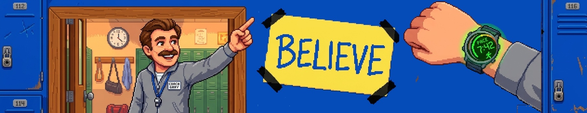
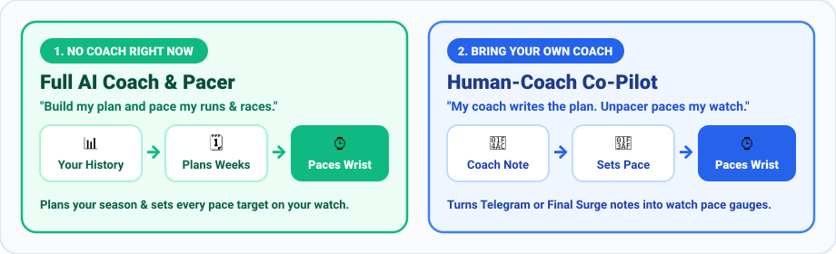
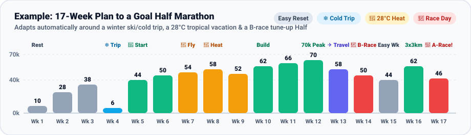
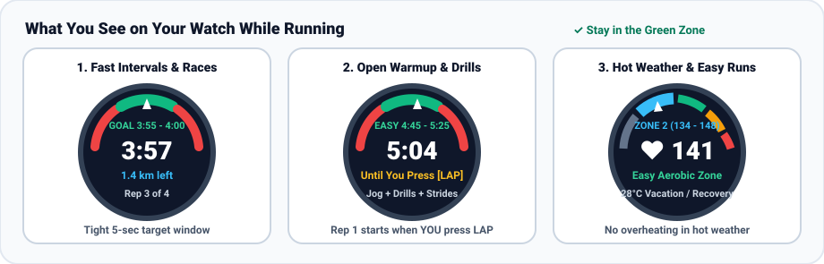
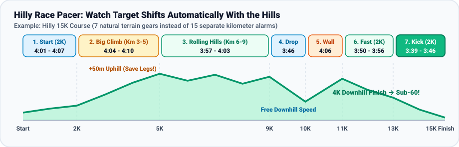
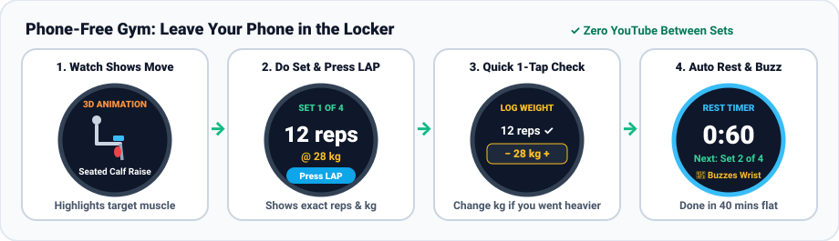

# Unpacer

**Stop staring at a blank watch or chasing a pace balloon.**
**`unpacer` is your personal AI pacer, race strategist, and training planner on your wrist.**

Most runners either guess their splits on the fly, stare at a tiny note scribbled on their hand, or burn out chasing a crowded race pacer up a hill.

`unpacer` is a pack of pacing and training skills you plug into the AI assistant you already use (Antigravity, Claude, Gemini, Cursor). It turns your watch into a smart pacer that knows your fitness, knows every hill on the course, and guides you through every kilometer and gym set.

**How it works (in 10 seconds):**
1. **Knows your true pace:** Reads your Garmin & Strava history + official race chip splits.
2. **Listens to you:** Takes your goal races, travel calendar, and how your last race actually felt.
3. **Plans `X` weeks ahead:** Builds (or adapts) your running and gym plan around real life.
4. **Paces every workout on your wrist:** Pushes intervals, easy runs, and 3D-animated gym sets to your watch.
5. **Paces race day:** Analyzes the course elevation, gives you a visual race-morning briefing in chat, and loads hill-by-hill pace gauges + text hints onto your watch.

---

## Two Ways to Use It

---

## What It Looks Like in Action

### 1. Plans `X` Weeks Ahead Around Your Real Life
Builds your next `4`, `12`, or `28` weeks from your watch history *(Garmin & Strava today; Apple Watch next)*, your race calendar, and how recent races felt. Taking a winter ski or cold-exposure trip, flying somewhere with `28°C` tropical heat, and fitting in a tune-up Half before your goal race? Your plan adapts in seconds:

* **Keeps your natural weekly rhythm:** If your history shows you run best on `4 days a week` with Mondays off, it keeps that shape and upgrades your key workouts and every second Sunday long run.
* **Remembers how races felt:** Tell it *"my chest felt redlined on the Km 5 hill after two coffees + energy drink"* or *"I lost 90 seconds at crowded water stations"*. It saves the lesson in your **Race Playbook** and fixes your next block.

---

### 2. Paces Every Run on Your Wrist (Zero Mental Math)
No more calculating splits in your head at `3:57/km`. Every workout step automatically opens Garmin's green/red pace or Heart Rate gauge on your watch:

* **Open Warmup on `LAP`:** Jog, do drills, and run strides at your own pace. Press `LAP` when you are ready to launch Rep 1.
* **Tight, Single-Gear Pace Windows:** Uses crisp `5 to 6 sec/km` bands, already adjusted `+2 to +3 sec/km` for city GPS corner drift so your watch pace actually hits your official chip goal.
* **Hot Weather Switch:** Automatically switches from pace targets to **Heart Rate Zone gauges (`Zone 1 to 5`)** when you travel somewhere hot (`28°C`) or high-altitude.

---

### 3. Pre-Race Briefing & Hill-by-Hill Course Pacer
Human race pacers run even effort or even splits poorly on hills. Before race day, `unpacer` analyzes the course elevation, wind, and start-corral logistics. You get **visual briefing cards in chat** plus a **multi-gear pacer on your watch** that shifts target pace automatically as the hills change:

| Pacer Gear | Course Section | Watch Pace Band | Split Target | Text Hint on Your Watch & Race Briefing |
| :--- | :--- | :--- | :--- | :--- |
| **1. Start** | **Km 1 to 2** | **`4:01 - 4:07/km`** | `8:08` @ 2K | **Hold back (`+12m`):** Don't weave in the crowd; stay `4:01/km` or slower. |
| **2. Climb** | **Km 3 to 5** | **`4:04 - 4:10/km`** | `20:29` @ 5K | **Big Hill (`+50m`):** Shorten stride, cap Heart Rate at `167 bpm`. |
| **3. Rollers** | **Km 6 to 9** | **`3:57 - 4:03/km`** | `36:29` @ 9K | **Rolling Hills:** Settle smoothly into `4:00/km` rhythm. |
| **4. Drop** | **Km 10** | **`3:46 - 3:52/km`** | `40:18` @ 10K | **Steep Downhill (`-22m`):** Lean from ankles, let gravity give you free speed. |
| **5. Wall** | **Km 11** | **`4:06 - 4:13/km`** | `44:27` @ 11K | **Final Climb (`+21m`):** Stay patient for 4 minutes before the fast finish. |
| **6. Fast** | **Km 12 to 13** | **`3:50 - 3:56/km`** | `52:13` @ 13K | **Catch Tailwind (`-18m`):** Crest the hill and open up into the `3:50s`. |
| **7. Kick** | **Km 14 to Finish** | **`3:39 - 3:46/km`** | **`59:48` Chip** | **Flying Finish (`-35m`):** Empty the tank; hit `STOP` on the finish mat! |

---

### 4. Paces Your Gym Sessions Too (Phone Stays in the Locker)
Opening YouTube videos between sets kills gym momentum. `unpacer` paces your strength sets and rest timers right on your wrist:

| Exercise on Your Watch (`Free-Gym A: Legs & Tendons`) | Sets × Reps | Start Weight | Auto-Rest | Text Hint on Your Watch |
| :--- | :--- | :--- | :--- | :--- |
| **1. DB Bulgarian Split Squat** *(3D Animation)* | `3 × 8 / leg` | `2 × 14 kg` | `75s` | Lean torso slightly forward; slow `3s` lower. |
| **2. Single-Leg DB Deadlift** *(3D Animation)* | `3 × 8 / leg` | `18 kg` | `75s` | Hold weight in opposite hand; keep hips flat. |
| **3. Seated Bent-Knee Calf Raise** *(3D Animation)* | **`4 × 12`** | **`28 kg`** | `60s` | **#1 Marathon armor!** `3s` down, `1s` pause, drive up. |
| **4. Single-Leg Standing Calf Raise** *(3D Animation)* | `3 × 12 / leg` | `14 kg` | `60s` | Full heel drop off step edge + high press. |
| **5. Side Plank** *(3D Animation)* | `3 × 30s` | `Bodyweight` | `45s` | `30s` Left + `30s` Right; keep hips high. |

---

## What Else Is Inside

* **[ROADMAP.md](ROADMAP.md)** - What is live today vs. what is coming next (Apple Watch support, 5-minute friend setup, automatic gym weight bumps).
* **[examples/](examples/)** - Interactive watch simulator and sample Garmin workout payloads ([Watch Gym Simulator](examples/fenix8_strength_simulator.html), [Sample Strength Workout JSON](examples/sample_strength_freegym_a.json)).
* **[skills/unpacer/SKILL.md](skills/unpacer/SKILL.md)** & **[scripts/unpacer_cli.py](scripts/unpacer_cli.py)** - The skill pack and Garmin/Strava helper for your AI assistant.

---

## Part of the `"Un-"` Series
* **[`undiary`](https://github.com/dnovakovskiy/undiary):** Turns years of your Telegram chats and voice notes into personal memory for your AI.
* **[`uncounter`](https://github.com/dnovakovskiy/uncounter):** Car rental agent for people who hate rental counters.
